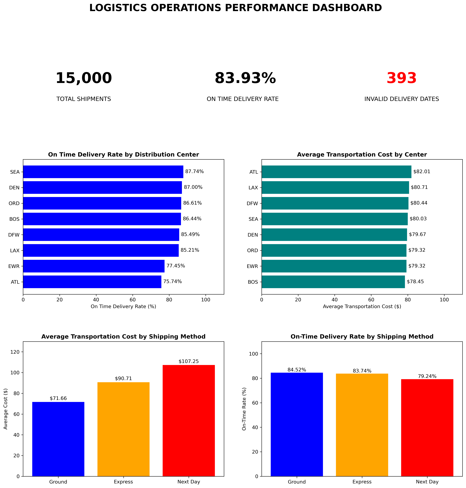

# Logistics Operations Analytics | SQL & Python

## Project Overview

This project analyzes 15,000 simulated logistics shipments to evaluate delivery reliability, transportation costs, and distribution center performance.

Using MySQL, Python, Pandas, and Matplotlib, I cleaned shipment data, calculated operational KPIs, identified performance differences, and developed a dashboard to communicate findings.

Project Type: Independent Data Analytics Portfolio Project  
Dataset: Simulated logistics data (not actual DHL operational data)

## Business Objectives

- Evaluate overall on-time delivery performance.
- Compare delivery reliability across eight distribution centers.
- Analyze transportation costs by distribution center and shipping method.
- Identify potential operational inefficiencies.
- Develop data-driven recommendations to improve logistics performance.

## Tools and Technologies

| Tool | Application |
| MySQL | Data cleaning, validation, and SQL analysis |
| Python | Data processing and analysis |
| Pandas | Data manipulation, grouping, and KPI calculations |
| Matplotlib | Data visualization and dashboard development |
| Jupyter Notebook | Reproducible Python analysis |
| GitHub | Project documentation and portfolio presentation |

## Data Preparation

The project began with 15,000 shipment records.

Data preparation included:

- Importing raw shipment data into MySQL staging tables.
- Checking for duplicate shipment IDs and missing values.
- Standardizing and validating shipment dates.
- Identifying 393 records with invalid delivery dates.
- Creating delivery status classifications for valid shipments.

After excluding invalid-date records, 14,607 shipments were available for delivery reliability analysis.

## Key Performance Indicators

| KPI | Result |
| Total Shipments | 15,000 |
| Valid Shipments | 14,607 |
| On-Time Deliveries | 12,259 |
| Late Deliveries | 2,348 |
| On-Time Delivery Rate | 83.93% |
| Invalid Delivery Dates | 393 |

The on-time delivery rate was calculated using valid shipments only.

## Dashboard

The dashboard contains three KPI cards and four visualizations:

1. On-Time Delivery Rate by Distribution Center
2. Average Transportation Cost by Distribution Center
3. Average Transportation Cost by Shipping Method
4. On-Time Delivery Rate by Shipping Method

## Key Business Findings

### 1. Distribution Center Performance

The Seattle (SEA) distribution center achieved the highest on-time delivery rate at 87.74%, while Atlanta (ATL) recorded the lowest at 75.74%.

This 12-percentage-point performance gap suggests an opportunity to investigate differences in operational processes, shipment characteristics, and delivery delays.

### 2. Transportation Cost by Distribution Center

Atlanta recorded the highest average transportation cost at $82.01 per shipment, while Boston recorded the lowest at $78.45.

Atlanta's combination of relatively high costs and lower delivery reliability makes it a priority for further investigation.

### 3. Shipping Method Cost Comparison

| Shipping Method | Average Cost |
| Ground | $71.66 |
| Express | $90.71 |
| Next Day | $107.25 |

Next Day shipping had the highest average transportation cost.

### 4. Shipping Method Reliability

| Shipping Method | On-Time Rate |
| Ground | 84.52% |
| Express | 83.74% |
| Next Day | 79.24% |

Next Day shipping recorded the lowest on-time delivery rate despite having the highest average cost.

Because each shipping method has different service commitments and shipment characteristics, additional analysis would be needed before drawing conclusions about efficiency or recommending service changes.

## Business Recommendations

Investigate Atlanta operations: Examine delay reasons, shipment volumes, transportation distances, and operational processes to identify potential causes of lower delivery reliability.

Review Next Day shipping performance: Analyze missed delivery commitments and determine whether delays are associated with particular distribution centers, routes, or shipment characteristics.

Improve data quality monitoring: Implement automated validation checks for delivery dates and shipment records to reduce reporting errors.

Develop ongoing KPI monitoring: Track on-time delivery rates, transportation costs, and data quality regularly to identify emerging performance issues.

## Skills Demonstrated

- SQL data cleaning and validation
- Relational database analysis
- Data quality assessment
- KPI development
- Python and Pandas data analysis
- Data visualization with Matplotlib
- Business performance analysis
- Analytical storytelling and recommendations

## Project Conclusion

This project demonstrates an end-to-end analytics workflow, from preparing raw logistics data to developing a performance dashboard and translating findings into actionable business recommendations.

The analysis highlights how SQL and Python can support operational reporting, performance monitoring, and data-driven decision-making.

*Disclaimer: This is an independent educational portfolio project using simulated logistics data. It is not affiliated with or endorsed by DHL.*
